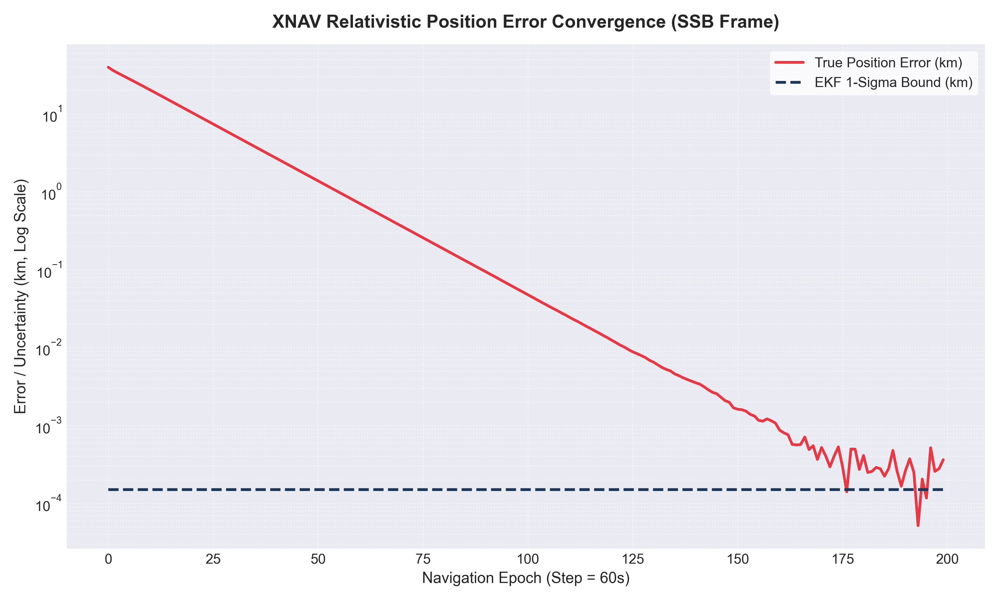

# pulsar-xnav-core

> Autonomous Deep-Space Relativistic Pulsar Navigation & Orbit Determination Engine (EKF/XNAV)


`pulsar-xnav-core` simulates autonomous interplanetary navigation for deep-space missions using high-precision X-ray millisecond pulsars (MSPs) as celestial navigation beacons, eliminating reliance on the terrestrial Deep Space Network (DSN).

---

## Convergence Telemetry

The Extended Kalman Filter ingests photon arrival phases and rapidly drives position uncertainty down across navigation epochs:



---

## Mathematical Architecture

### 1. Relativistic Time-of-Arrival (TOA) Model

Light signals received at spacecraft time $t_{sc}$ are transformed to the Solar System Barycentre (SSB) coordinate frame $t_{ssb}$:

$$t_{ssb} = t_{sc} + \Delta t_{\text{Rømer}} + \Delta t_{\text{Shapiro}}$$

**Rømer Delay (Geometric Time-of-Flight):**
$$\Delta t_{\text{Rømer}} = \frac{\mathbf{r}_{sc} \cdot \mathbf{n}_i}{c}$$

**Shapiro Delay (Gravitational Curvature Delay around the Sun):**
$$\Delta t_{\text{Shapiro}} = -\frac{2 G M_\odot}{c^3} \ln \left( 1 + \mathbf{n}_i \cdot \frac{\mathbf{r}_{sc}}{\|\mathbf{r}_{sc}\|} \right)$$

### 2. Celestial Pulsar Catalog
The state estimator tracks observations from real astrophysical sources:
* **PSR B1937+21** ($P \approx 1.557\text{ ms}$)
* **PSR B1821-24** ($P \approx 3.054\text{ ms}$)
* **PSR J0437-4715** ($P \approx 5.757\text{ ms}$)
* **Crab PSR B0531+21** ($P \approx 33.39\text{ ms}$)

### 3. State Estimation Filter
* **State Vector:** $\mathbf{x} = [x, y, z, \dot{x}, \dot{y}, \dot{z}]^T$
* **Dynamics:** Heliocentric 2-body gravitational acceleration $\ddot{\mathbf{r}} = -\mu_\odot \frac{\mathbf{r}}{\|\mathbf{r}\|^3}$
* **Measurement Sensitivity Jacobian:**
  $$\mathbf{H} = \frac{1}{c} \mathbf{n}_i^T$$

---

## Build & Execution

### Compile Core C++ Engine:
```bash
g++ -std=c++17 src/main.cpp -Iinclude -o xnav_engine
./xnav_engine